# Execution Agent — Guided Tour

> No presenter needed. This document walks you through a full trade cycle from submission to dispatch.  
> Run the app locally and follow along — see [README.md](README.md) for startup instructions, and [docs/known-gaps.md](docs/known-gaps.md) for what this POC deliberately does not do.

---

## What this tool demonstrates

Execution desks face a problem that has two distinct halves. The strategic half — *when* to trade, *what* algorithm to use, *how many* pieces to slice an order into — involves qualitative reasoning under uncertainty. The quantitative half — *exactly* what a slice will cost in slippage, fill price, and market impact — is deterministic math that an LLM has no business doing.

This tool enforces that boundary architecturally. The LLM chooses an algorithm label and a slice count. Python computes the slice size. A C++20 order book engine, called through pybind11, computes the numbers. A LangGraph graph orchestrates both and pauses mid-run for the trader to review; nothing is dispatched unless the trader approves **and** the approval gate confirms there are current engine numbers for the plan being approved.

---

## 1. The Trade Dashboard

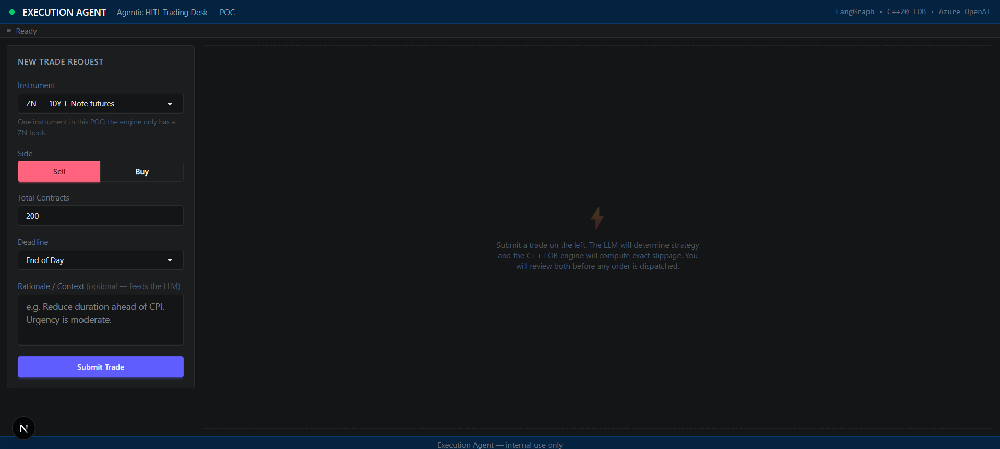

The form is prefilled with the default demo trade — ZN, sell, 200 contracts, end of day. ZN is the only instrument: the engine has one order book (a reconstructed ZN snapshot), so the API rejects any other instrument with `422` rather than pricing it against the wrong book. Side (Buy/Sell) is an explicit, required field — never inferred from the free-text rationale and never defaulted by the API.

The rationale field is forwarded to the LLM as context for strategy selection ("macro catalyst", "rebalance before close"). If left blank, the form builds a default prompt from its values.

On submit:

1. `POST /api/trade` validates the payload (strict integers, bounded strings, registered instrument)
2. LangGraph runs `strategy_node` — the LLM call
3. `simulation_node` calls the C++ LOB engine for one slice
4. The graph reaches `hitl_node`, checkpoints its state to SQLite, and returns
5. The frontend fetches the paused state and renders the HITL panel

The LLM call takes seconds. The C++ sweep takes tens of nanoseconds. The loading indicator is entirely the LLM.

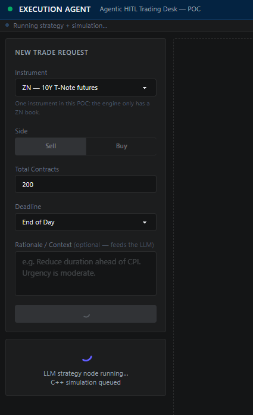

---

## 2. The HITL Review Panel

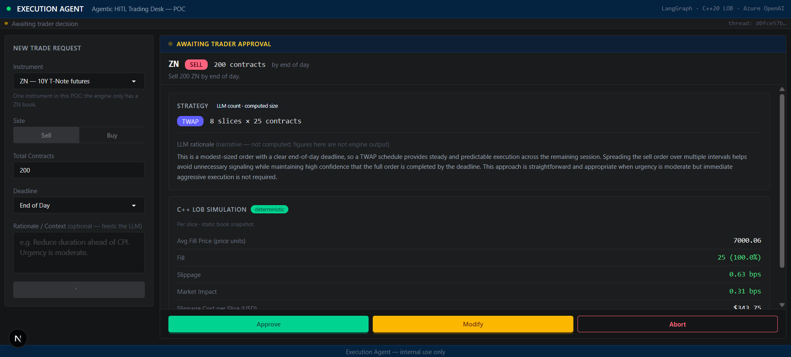

The panel shows the strategy and the engine's numbers together, and three actions: **Approve**, **Modify**, **Abort**. The graph waits in this state indefinitely — it is checkpointed to SQLite and holds until resumed.

**Approve is enabled only when the backend's approval gate passes** (`backend/pipeline/plan.py:approval_block_reason`):

- a strategy exists and is not an unconfirmed fallback
- C++ metrics exist for the **current** revision of the plan
- the last simulation for this plan did not fail

When the gate fails, the button is disabled and the reason is shown beneath it. The backend applies the same gate again on `POST /api/resume` (409) and the graph router applies it a third time, so the button is a convenience, not the control.

---

## 3. Strategy Card

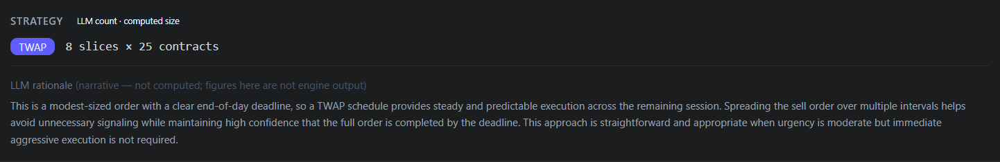

- **Algorithm** — VWAP, TWAP, Sweep, or Iceberg (an LLM choice)
- **Slices × contracts** — the LLM picks a slice *count* (Pydantic-bounded 1–20). Python computes the size (ceil of total ÷ count) and normalises the count so no slice is empty — e.g. a request for 8 slices of a 20-lot order becomes 7 × 3
- **Origin badge** — who chose the slice parameters in force: *LLM count · computed size*, *Trader override*, or *Fallback default*
- **LLM rationale** — labelled as narrative. Any figure the model writes there is not engine output

If the LLM is unavailable, the strategy falls back to a deterministic VWAP plan marked *Fallback default*, and **approval is blocked** until the trader confirms a slice count with Modify. Nothing reaches dispatch that neither the model chose nor a human confirmed.

---

## 4. Metrics Card — C++ Engine Output

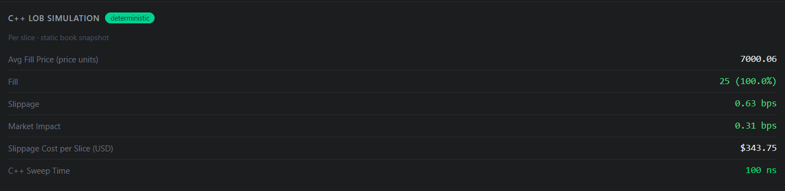

The engine sweeps **one child order** (one slice) immediately against the static ZN book — the bid side for a sell, the ask side for a buy. All metrics are **per slice**:

| Metric | Description |
|---|---|
| Avg fill price (price units) | Volume-weighted average across swept levels, in the book's raw price units (1 tick = 0.5) |
| Fill | Contracts filled and fill ratio — red if the book exhausted before the slice completed |
| Slippage (bps) | Adverse basis points vs the arrival price (positive = worse, both directions), computed on the raw price index |
| Market impact (bps) | Half-slippage proxy — a placeholder, not a calibrated model |
| Slippage cost per slice (USD) | Converted from price units via ZN's tick metadata: 0.5 price units = 1 tick = $15.625 per contract |
| C++ sweep time (ns) | `steady_clock` time inside `ExecutionSimulator::simulate()` |

Partial fills, and use of the synthetic fallback book when the market-data file is absent, appear as warnings next to the Approve gate.

**Latency, stated precisely.** Two different numbers are easy to conflate:

| What | Typical value | How to reproduce |
|---|---|---|
| The C++ sweep alone | tens of nanoseconds (≈ 35–75 ns on the author's Linux host) | `simulation_latency_ns` per call; `benchmark_simulate.py` prints the distribution |
| One call from Python, including the pybind11 crossing and GIL release/re-acquire | ≈ 0.4–0.7 µs | `python benchmark_simulate.py` (100,000 calls, p50/p99) |

The per-call figure is dominated by the language crossing, not the sweep. Both are host-dependent. Zero heap allocation inside `simulate()` was verified with an allocation-counting harness over 1,000,000 calls.

The strategy label (VWAP / TWAP / Sweep / Iceberg) does **not** change these numbers — only the slice size does. Simulating the schedule itself is out of scope for this POC.

---

## 5. Approving the Trade

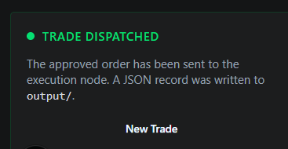

Click **Approve** when the gate is green. The graph resumes into `execution_node`, which logs the order and writes `output/trade_<thread_id>.json`:

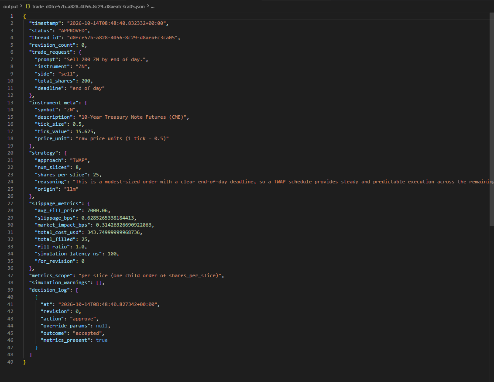

The record holds the trade request, the strategy in force (with its `origin`), the per-slice metrics and the revision they were computed for, current warnings, instrument metadata used for the unit conversion, and the full **decision log** — every revise, refused approval and the final approval, in order. It is a local convenience record, not a compliance-grade audit log: there is no user identity and the file is mutable (see [docs/known-gaps.md](docs/known-gaps.md)).

A second Approve on the same trade returns `409` — it cannot dispatch twice.

---

## 6. Modifying Before Approval

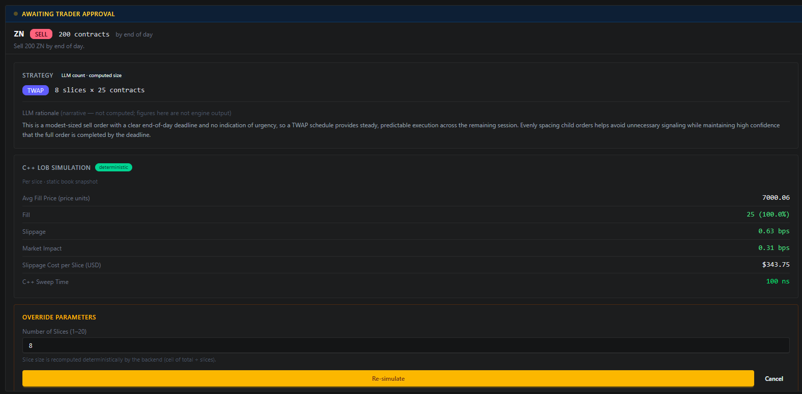

Click **Modify** to change the **slice count** (1–20). The backend recomputes the slice size with the same rule it applies to the LLM's choice and re-runs the C++ sweep:

```json
POST /api/resume/{thread_id}
{"action": "revise", "override_params": {"num_slices": 8}}
```

Overrides are validated exactly like LLM output: strict integers within bounds, no other keys. A trader cannot rewrite the algorithm label or the LLM's rationale through this path, and a plan that would not cover the order is rejected with `422`. The API also accepts `shares_per_slice` instead (the count is then derived), but not an inconsistent pair.

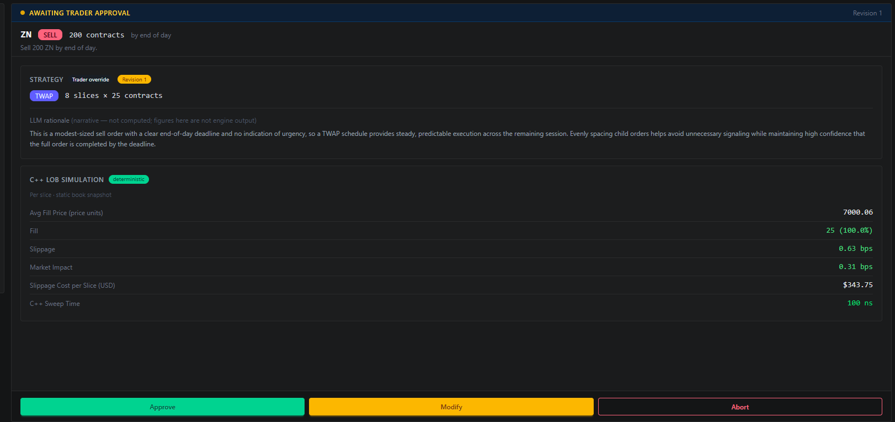

The panel refreshes with the new plan, its origin becomes *Trader override*, and the revision counter increments. If the re-simulation fails, the old numbers are **cleared** rather than left on screen, and Approve stays disabled until a simulation for the current plan succeeds.

---

## 7. The Abort Path

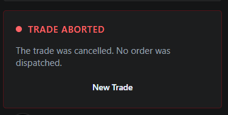

Click **Abort** and the graph routes to `END`. No order is dispatched, no output file is written, and the API reports `status: "aborted"`. A later Approve on that trade returns `409`. The strategy and metrics computed before the abort remain in the local SQLite checkpoint.

---

## 8. Terminal — Pipeline and C++ Logs

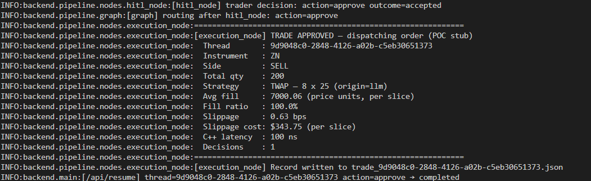

The backend log shows each trade cycle. An approved trade ends with the `execution_node` summary block (example values):

```
Thread       : 3f0c…
Instrument   : ZN
Side         : SELL
Total qty    : 200
Strategy     : TWAP — 8 x 25 (origin=llm)
Avg fill     : 7000.06 (price units, per slice)
Fill ratio   : 100.0%
Slippage     : 0.63 bps
Slippage cost: $343.75 (per slice)
C++ latency  : 70 ns
Decisions    : 1
```

The book-loader line reports `10 bid levels, 5 ask levels — spread 0.0 price units`. The default 09:30 snapshot reconstructs as a **locked** book (best bid equals best ask) — an artefact of anchoring both sides to the last trade price, documented in the known gaps.

---

## Notes for reviewers

**Suggested demo trade:** `ZN`, sell, 200 contracts, end of day, rationale: `reducing duration exposure before close`.

**Probes worth trying** — each is covered by `tests/test_graph_boundary.py`:

- Modify with `num_slices: 999`, `"approach": "YOLO"` or a string value → `422`, plan unchanged
- Submit `instrument: "TSLA"` or `total_shares: 0` → `422`
- Approve twice, or approve after abort → `409`
- Resume a thread ID that does not exist → `404`
- Stop the LLM (bad key) → fallback plan, Approve blocked until Modify

**What this tool is not:** see [docs/known-gaps.md](docs/known-gaps.md). In short: one instrument, one static book snapshot, one slice simulated, no live OMS, no user identity or entitlements, and a market-data file of unverified provenance.
